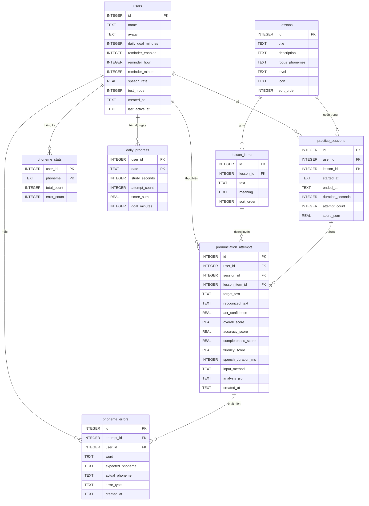

# Thiết kế cơ sở dữ liệu – LearnEN

CSDL: **SQLite** cục bộ trên thiết bị (plugin `sqflite`), file `learn_en.db`, phiên bản schema `1`.
Mã nguồn: [lib/data/app_database.dart](../lib/data/app_database.dart), truy vấn trong [lib/data/repositories/](../lib/data/repositories/).

## Sơ đồ quan hệ (ERD)



## Mô tả các bảng

| Bảng | Vai trò | Ghi chú |
|---|---|---|
| `users` | Thông tin người học + cài đặt cá nhân (mục tiêu phút/ngày, giờ nhắc, tốc độ đọc mẫu, chế độ kiểm thử) | Một thiết bị có nhiều người học |
| `lessons`, `lesson_items` | Giáo trình: 10 bài theo nhóm âm khó với người Việt, mỗi bài 6–9 từ/câu | Nạp sẵn khi tạo CSDL từ [lesson_catalog.dart](../lib/data/lesson_catalog.dart) |
| `practice_sessions` | Một lần mở màn hình luyện tập: thời gian học thực, số lượt, tổng điểm | |
| `pronunciation_attempts` | **Lịch sử luyện tập**: mỗi lượt nói, câu mẫu, câu AI nghe được, độ tin cậy ASR, 4 điểm thành phần | `analysis_json` lưu toàn bộ kết quả phân tích (từng từ, từng âm, gợi ý, bài tập) để xem lại |
| `phoneme_errors` | **Kết quả phân tích phát âm** dạng chuẩn hóa: mỗi âm sai là một dòng (`substitution` / `deletion` / `insertion`) | Dùng thống kê "lỗi hay gặp nhất" |
| `phoneme_stats` | Bộ đếm theo âm vị: số lần xuất hiện / số lần sai của từng người | Tính "âm yếu nhất" nhanh, không cần quét toàn bộ lịch sử |
| `daily_progress` | Tổng hợp theo ngày: giây học, số lượt, tổng điểm, mục tiêu ngày đó | Nguồn dữ liệu cho **streak**, vòng mục tiêu ngày, biểu đồ, lịch luyện tập |
| `app_meta` | Khóa/giá trị chung (người dùng đăng nhập gần nhất) | |

## Quyết định thiết kế

- **Khóa ngoại + `ON DELETE CASCADE`** (bật `PRAGMA foreign_keys = ON`): xóa một người học sẽ xóa toàn bộ dữ liệu của người đó.
- **Ngày lưu dạng `TEXT yyyy-MM-dd` theo giờ địa phương** → streak đúng theo ngày của người dùng, không lệch múi giờ.
- **Không dùng UPSERT** (`ON CONFLICT DO UPDATE` cần SQLite ≥ 3.24, Android 7–10 không có). Thay bằng `INSERT OR IGNORE` + `UPDATE` trong cùng batch/transaction.
- **Lưu lượt nói trong một transaction**: attempt + phoneme_errors + phoneme_stats + practice_sessions + daily_progress cập nhật cùng lúc, không bao giờ lệch nhau.
- **Thời gian học** chỉ cộng giữa các lần tương tác (tối đa 2 phút/khoảng) và dừng khi app chạy nền – xem [study_timer.dart](../lib/services/study_timer.dart).
- **Chỉ mục**: `(user_id, created_at)` cho lịch sử, `(user_id, lesson_item_id)` cho điểm cao nhất từng câu, `(user_id, expected_phoneme)` cho thống kê lỗi.

## Truy vấn tiêu biểu

Âm yếu nhất của một người học (tỉ lệ sai cao nhất, xuất hiện ≥ 3 lần):

```sql
SELECT phoneme, total_count, error_count
FROM phoneme_stats
WHERE user_id = ? AND total_count >= 3 AND error_count > 0
ORDER BY CAST(error_count AS REAL) / total_count DESC, error_count DESC
LIMIT 3;
```

Tiến độ từng bài học (số câu đã luyện, trung bình điểm cao nhất):

```sql
SELECT li.lesson_id, COUNT(*) AS item_count, COUNT(best.item_id) AS practiced, AVG(best.best_score) AS best_avg
FROM lesson_items li
LEFT JOIN (SELECT lesson_item_id AS item_id, MAX(overall_score) AS best_score
           FROM pronunciation_attempts WHERE user_id = ? AND lesson_item_id IS NOT NULL
           GROUP BY lesson_item_id) best ON best.item_id = li.id
GROUP BY li.lesson_id;
```
